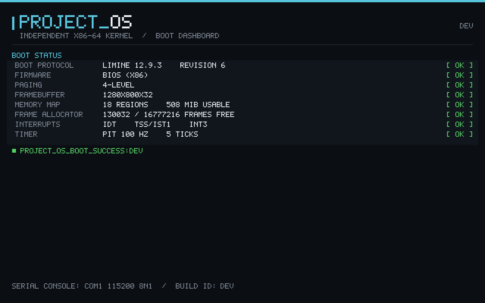

# PROJECT_OS

An independent operating system with its **own x86-64 kernel**, heading toward
native Windows application support without Wine/Proton or CPU translation.

> **Status: Phase 1 boot milestone.** The kernel boots from a BIOS/UEFI hybrid ISO
> under QEMU (BIOS path verified), validates the Limine handoff, records the
> firmware memory map, drives a framebuffer dashboard, runs a physical frame
> allocator self-test, installs GDT/IDT/TSS, handles a deliberate `int3`, and
> receives 5 PIT timer interrupts before printing a success marker. There is
> **no user mode, no filesystem, no networking and no Windows application
> support** yet. A booting kernel does not imply Windows compatibility.

## What this is — and is not

- It is a new modular monolithic kernel written in freestanding Rust, with
  minimal assembly for the entry stub and interrupt frames.
- It is **not** Linux, not a Linux distribution, not the Windows NT kernel.
- It does **not** use Wine, Proton, DXVK/VKD3D-Proton, QEMU user-mode emulation or
  binary translation. The x86-64 Windows path is a future first-party PE loader
  plus first-party Windows-compatible services.
- Limine is the bootloader. A bootloader is not the OS kernel.

## Quick start

All scripts are Bash (Git Bash on Windows, any POSIX shell environment on Linux)
and locate the repository root themselves.

```sh
scripts/bootstrap.sh        # verify toolchain, target and optional VM tools
scripts/build.sh            # build kernel
scripts/make_iso.sh         # fetch/verify pinned Limine, create hybrid ISO
scripts/test_boot_qemu.sh   # headless QEMU BIOS boot; success marker required
scripts/test_virtualbox.sh # isolated VirtualBox VM; skipped when VBoxManage is absent
```

Artifacts:

- Kernel ELF: `artifacts/kernel.elf` (higher-half, fixed load address)
- ISO: `artifacts/project-os.iso` (BIOS + UEFI El Torito entries)
- Serial log: `artifacts/qemu-serial.log`

Expected serial line:

```text
PROJECT_OS_BOOT_SUCCESS:<build-id> checks=handoff,memmap,gdt,idt,exceptions,timer,allocator
```

`scripts/test_boot_qemu.sh` requires the `isa-debug-exit` device and expects QEMU
status 33 (the kernel writes `0x10` to port `0xf4` after the marker). On
VirtualBox the write is ignored and the kernel idles.

### VirtualBox

`scripts/test_virtualbox.sh` creates a uniquely named, isolated VM with
`VBoxManage`, attaches the ISO, captures COM1 to
`artifacts/vbox-serial.log`, checks the marker, then deletes only that VM. If
`VBoxManage` is absent it prints manual steps and exits with **SKIP (code 2)**.
VirtualBox 7.2.20 BIOS boot **passes** here: the guest reaches
`PROJECT_OS_BOOT_SUCCESS` and the kernel reports timer ticks. The kernel maps
the local-APIC MMIO page and configures LINT0 ExtINT so the 8259's IRQ0 is
accepted; no non-default VM options are needed.

### UEFI

The ISO contains a verified UEFI El Torito entry (`platform 0xEF`, no emulation).
A UEFI **boot test** requires OVMF firmware and is not run here:

```sh
OVMF_FD=/path/to/OVMF.fd scripts/test_boot_qemu.sh --firmware uefi
```

Without `OVMF_FD` the script reports SKIP. Do not read the ISO catalog check as a
UEFI boot test.

## Requirements

| Tool | Purpose | Notes |
|---|---|---|
| Rust 1.99.1 + `x86_64-unknown-none` | kernel | `rustup target add x86_64-unknown-none` |
| `mkisofs` (cdrtools 3.02a09 tested) | ISO creation | `scoop install cdrtools`; xorriso is not required |
| Limine 12.9.3 binaries | bootloader | fetched, SHA-256 pinned in `scripts/fetch_limine.sh` |
| QEMU 11.1.0 (optional) | automated boot test | `scoop install qemu` |
| VirtualBox 7.2 + VBoxManage (optional) | compatibility smoke test | installed here; script skips cleanly if absent |
| Python 3 (optional) | El Torito catalog verification | stdlib only |

No package installation is performed automatically and no elevation is used.

## Layout

```text
kernel/            freestanding kernel (entry, Limine ABI, arch, display, memory)
os_core/           host-testable, architecture-independent logic
tools/membench/    reproducible host frame-allocator benchmark
boot/              limine.conf and pinned-bootloader metadata
scripts/           build, ISO, tests, format, lint, benchmark
docs/              architecture, decisions, research, testing, memory, graphics,
                   Windows compatibility, roadmap
artifacts/         generated kernel/ISO/logs (Git-ignored)
```

## Boot dashboard



Captured from QEMU 11.1.0 with the monitor `screendump` command. This is the
bootloader framebuffer, not a GPU driver or a desktop environment.

## Verification snapshot (2026-10-17)

- Full suite (`scripts/test_all.sh`): **13 PASS, 0 FAIL, 4 SKIP**.
- Host unit tests: **33 passed** (`cargo test -p os_core`).
- Kernel build: ELF64, entry `0xffffffff80000000`, `.limine_requests` present.
- ISO: 6,285,312 bytes, both BIOS and UEFI El Torito entries verified; Limine,
  Rust runtime and project license notices are included under `/licenses`.
- QEMU BIOS boot: succeeded at 256 MiB, 512 MiB and 1 GiB; each reached the
  success marker and exited via `isa-debug-exit` with status 33.
- **VirtualBox 7.2.20 BIOS boot: PASS**; reached the same marker with 5 timer
  ticks and only the default VM configuration.
- In-kernel: allocator self-test passed, `int3` handler ran, 5 PIT ticks observed.
- Negative test: corrupting the ISO made the boot script fail with exit 1.
- UEFI boot: **SKIP** (OVMF not available); ISO entry verified only. This is
  now the only unverified Phase 1 boot path.
- Windows/GPU/driver compatibility: **not implemented**.

See [progress.md](progress.md), [docs/TESTING.md](docs/TESTING.md) and
[docs/RESEARCH.md](docs/RESEARCH.md) for exact commands, results and sources.

## Platform notes

This checkout is on Windows, whose filesystem is case-insensitive. `AGENTS.md`
is canonical and `agents.md` resolves to it; `stop.md`/`STOP.md` and
`progress.md`/`PROGRESS.md` likewise resolve to one file each. Do not create
duplicate files whose contents could diverge. On a case-sensitive filesystem,
create lowercase pointer files that reference the canonical uppercase names.

## License

Project source is MIT (see [LICENSE](LICENSE)). Third-party components, tool versions and
obligations are recorded in [LICENSES.md](LICENSES.md). No Linux, Windows, Wine,
ReactOS or NVIDIA implementation code is copied into this repository.
